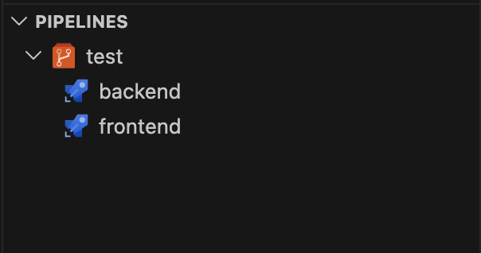
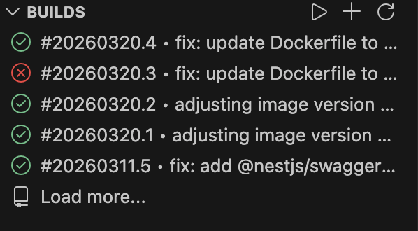
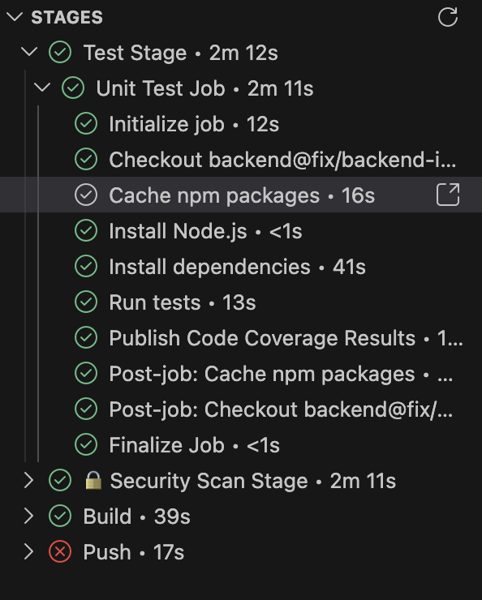

# Azure Pipelines Runner

Your Azure DevOps pipelines, right where you code.

Monitor builds, stages, jobs, and task logs directly from the VS Code sidebar. No more context-switching just to check if your pipeline passed.

---

## Features

- **Live build monitoring** — Real-time build status with configurable auto-polling
- **Full pipeline hierarchy** — Navigate from project → pipeline → build → stage → job → task
- **Log viewer** — Inspect task logs with syntax highlighting directly in the editor
- **Run & cancel builds** — Trigger new runs or cancel in-progress builds from the sidebar
- **Stage approvals** — Approve or reject pending stage gates without opening the browser
- **Retry failed stages** — Re-run a failed stage with a single click
- **Build retention** — Mark builds to prevent automatic deletion
- **Multiple accounts** — Connect to multiple Azure DevOps organizations simultaneously
- **Microsoft sign-in** — Authenticate with your Microsoft account (recommended) or a Personal Access Token
- **Secure credential storage** — Credentials are stored using VS Code's built-in Secret Storage

---

## Screenshots

### Pipelines

### Builds

### Stages, Jobs & Tasks

---

## Getting Started

1. Install the extension from the [VS Code Marketplace](https://marketplace.visualstudio.com/items?itemName=PedroCaetano.azure-pipeline-runner)
2. Open the **Azure Pipelines Runner** panel in the sidebar
3. Click **Add Account** and choose how to connect:
   - **Sign in with Microsoft** *(recommended)* — uses your Microsoft account via VS Code's built-in auth provider; no PAT needed
   - **Personal Access Token (PAT)** — enter your organization name and a [PAT](https://learn.microsoft.com/en-us/azure/devops/organizations/accounts/use-personal-access-tokens-to-authenticate) manually
4. Your projects, pipelines, and builds will load automatically
5. You can add multiple accounts and switch between them at any time from the Accounts view

---

## Requirements

- An **Azure DevOps Services** (cloud) account
- Authentication — choose one:
  - **Microsoft account** *(recommended)* — your organization must be linked to Azure AD and you must be a member of the organization
  - **Personal Access Token (PAT)** with the following scopes:
    - **Build**: Read & Execute
    - **Release**: Read, Write, Execute & Manage

> **Note:** Azure DevOps Server (on-premises) is not supported.

---

## Extension Settings

| Setting | Default | Description |
|---|---|---|
| `azurePipelinesRunner.enablePolling` | `true` | Automatically refresh build status |
| `azurePipelinesRunner.pollingIntervalSeconds` | `5` | Polling interval in seconds (1–60) |
| `azurePipelinesRunner.buildsPerPage` | `5` | Number of builds to show per pipeline (1–50) |

No manual configuration required — accounts are managed through the Accounts view.

> **Migration note:** If you previously stored credentials in `settings.json`, they will be automatically migrated to secure storage on first activation.

---

## Contributing

Found a bug or have an idea? All contributions are welcome.

- **Bug reports & feature requests** — [Open an issue on GitHub](https://github.com/pedroccaetano/azure-pipeline-runner/issues)
- **Pull requests** — Clone the repo, run `npm install`, and press `F5` in VS Code to launch the Extension Development Host

---

## Roadmap

Track upcoming features and progress on the [GitHub Project Board](https://github.com/users/pedroccaetano/projects/2).

---

## Changelog

See [CHANGELOG.md](CHANGELOG.md) for the full release history.
